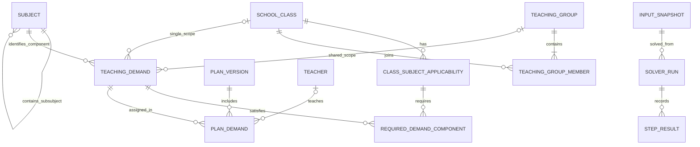

# Hợp đồng dữ liệu bổ sung cho bản Alternate - 31/10/2026

Áp dụng cùng SRS Alternate, Q-03/05/08/09/13/15/24. Đây là đặc tả thiết kế cập nhật, chưa phải migration CSDL đã chạy. Ảnh ERD 41 bảng và DG-06/07 hiện hành là ảnh nguồn lịch sử, chưa được vẽ lại. Khi ảnh khác văn bản này, dùng hợp đồng văn bản để triển khai các thay đổi dưới đây; Q-02 giữ chưa chốt.

| Đối tượng | Dữ liệu/quan hệ cần lưu | Bất biến |
|---|---|---|
| Teacher, SchoolClass, Subject | ID bất biến; tên hiển thị; phạm vi đơn vị/năm phù hợp | Không ghép hai người theo tên Trúc; không bỏ hậu tố lớp khi chưa ánh xạ |
| SourceAlias | source_file_hash, sheet, ô, alias, loại thực thể, target_id, người/thời điểm xác nhận | Bí danh chỉ được resolve khi có ánh xạ được xác nhận; lưu giá trị nguồn |
| Subject / SubSubject | parent_subject_id hoặc quan hệ cha-con chuẩn hóa; Lý/Hóa/Sinh thuộc KHTN | Qualification theo đúng phân môn và cấp; quyền Lý không tự sinh quyền Hóa/Sinh |
| ClassSubjectApplicability | lớp, môn/phân môn, học kỳ, trạng thái, nguồn và người/thời điểm xác nhận | APPLICABLE / NOT_APPLICABLE / UNDETERMINED khác nhau; chưa xác định không bị chuyển thành không phát sinh |
| RequiredDemandComponent | applicability_id, demand_type, khoảng hiệu lực, demand_id đáp ứng | Mỗi thành phần bắt buộc tham chiếu đúng nhu cầu; có thể dùng nhu cầu của nhóm ghép |
| TeachingGroup | group_id, môn/phân môn, kỳ, khoảng hiệu lực, nguồn xác nhận | Chỉ một phạm vi giảng dạy chung được xác nhận; không phải phòng hoặc slot thời khóa biểu |
| TeachingGroupMember | group_id, class_id, khoảng hiệu lực | Duy nhất thành viên theo hiệu lực; các lớp phải tương thích kỳ và môn/phân môn |
| TeachingDemand | demand_id, class_id hoặc group_id, subject/subsubject_id, semester_id, demand_type, periods, load_basis, khoảng hiệu lực, nguồn | Đúng một trong class_id/group_id có giá trị; loại STANDARD / SPECIALIZED_TOPIC / ENRICHMENT; số tiết dương khi áp dụng |
| TeachingDemand của nhóm | một group_id và quan hệ tới mọi lớp thành viên | Một gán GV, một lần tải; không tạo nhu cầu đơn lớp trùng thành phần/hiệu lực nhóm ghép |
| TeacherQualification | teacher_id, subject/subsubject_id, level_id, hiệu lực, chứng cứ và xác nhận | GV đủ quyền với toàn bộ lớp thành viên của nhu cầu ghép |
| TeacherEmployment | đơn vị, học kỳ, cấp hồ sơ/chức danh THCS hoặc THPT, hiệu lực và trạng thái công tác | B=19/17 cho chế độ thông thường; nghỉ toàn kỳ không nhận gán; TLTN/định mức đặc thù và thỉnh giảng/hợp đồng là mở rộng |
| TeacherDuty | loại nhiệm vụ, teacher_id, class_id nếu GVCN, hiệu lực, reduction, source_rule/evidence, chi trả, xác nhận | Đã chọn 5 nhóm; mức công đoàn và điều kiện PTN còn cần dữ liệu. Không tính lại cùng khoản vào C |
| WorkloadBreakdown | B, R, Q=max(0,B−R), F, A, C, W=F+A+C, T=W+R, kỳ/đơn vị/nguồn | F không chứa lại gán trong A. C không chứa nhiệm vụ đã ở R. Khi R≤B, T−B=W−Q; không dùng T−Q |
| PlanDemand | version_id, demand_id, teacher_id, reason khi chưa gán; is_locked, locked_by/at/reason | Duy nhất version–demand. Khóa phải có GV hợp lệ. Nhóm ghép vẫn một dòng gán, khi hiển thị lớp dùng quan hệ thành viên |
| OptimizationConfig | schema/version, objective_order=[Z,L1,MAX_DEVIATION,CHANGES], experience_enabled=false, total_budget, step_budgets, group policy và nguồn xác nhận | Tổng budget 30–60 giây; Q-02 chưa có mặc định. Đầu vào nghiệm thu phải có chính sách đã xác nhận; không tự chọn hoặc âm thầm fallback |
| SolverRun / StepResult | snapshot/config/rules hash; từng bước objective, status, incumbent value, best_bound, exact_proof, seconds, stop_reason; selected_step và applied_revision | proof từng mục tiêu riêng; bước cuối tối ưu không chứng minh mục tiêu trước. Giữ nghiệm hợp lệ trước nếu bước sau không có nghiệm |
| InputSnapshot | toàn bộ dữ liệu trên cùng phiên bản, scale/đơn vị, nguồn, dữ liệu còn thiếu | Bất biến, không chỉ ID tới dữ liệu sống; kết quả cũ không áp dụng khi revision/token đổi |

Sơ đồ bổ sung sau mô tả quan hệ mới; không thay toàn bộ ERD 41 bảng:

Cardinality trên hai quan hệ phạm vi của TeachingDemand phải đi kèm XOR class_id/group_id; Mermaid không tự diễn đạt được ràng buộc này.

Ví dụ nhóm G_A1_A2 có thành viên 12A1/12A2, chuyên đề 1 tiết: chỉ một Demand và một PlanDemand. Tải GV tăng 1; bảng theo lớp hiển thị tham chiếu cùng Demand ở cả hai lớp và ghi “học chung”, không cộng hai dòng hiển thị thành 2 tiết GV. CoverageMode.COMPONENTS đếm nhu cầu này một lần; thống kê thiếu chương trình theo lớp cần chiếu lại qua RequiredDemandComponent.

Q-02: lưu tên chính sách và nguồn xác nhận, có thể là cùng GV cứng / cho tách / ưu tiên mềm; chưa chốt cấu hình mặc định hoặc chi phí mềm. Không sinh migration đặt true chỉ từ ghi chú cũ.

Nguồn và thứ tự ưu tiên: E3 năm 2026–2027, Bảng Tổ ưu tiên sau ánh xạ ID. Khi khác Bảng Trường phải lưu cả hai giá trị và căn cứ chọn. Ô trống ở nguồn E3 theo Q-10 là không phát sinh nhu cầu; không dùng điều này để xóa nhu cầu đã xác nhận hoặc diễn giải teacher_id=NULL của DRAFT là không áp dụng.

Chuẩn hóa E3 đã chốt: 1,25/1,4 có đơn vị tiết tuần/lớp;2+1* tạo STANDARD=2 và SPECIALIZED_TOPIC=1, tổng3;dòng tổng 10A2=3 cần tách STANDARD=2 và SPECIALIZED_TOPIC=1 cùng GV;tt là ENRICHMENT. TH trong cột lớp là bí danh, không phải ký hiệu tải. Dòng tổng phải đối chiếu kế hoạch thành phần và GV; không suy tất cả 3 tiết thành STANDARD hoặc SPECIALIZED_TOPIC.

Ví dụ ánh xạ dòng tổng sau hiệu chỉnh:

| Nguồn | Các nhu cầu/gán sau chuẩn hóa | Tải GV |
|---|---|---|
| 10A2 (CHUYÊN ĐỀ), G61=3 | STANDARD=2 và SPECIALIZED_TOPIC=1, cùng teacher_id của cô Đỗ Trúc | 2+1=3, không giữ thêm một nhu cầu tổng 3 |
| 12A1 thường | STANDARD=2, cô Đỗ Trúc | 2 cho cô Đỗ Trúc |
| Nhóm chuyên đề 12A1+12A2, G79=1 | Một SPECIALIZED_TOPIC=1 của nhóm, cô Lơn; cả hai lớp tham chiếu cùng demand_id | 1 cho cô Lơn, không nhân hai lớp |

Phải phân biệt dòng tổng nguồn và thành phần nhu cầu chuẩn hóa. Số 3 tự nó không xác định thành phần. Cùng GV trong dữ liệu thực tế không tự tạo ràng buộc cứng cùng GV cho tất cả nhóm; chính sách mặc định/ưu tiên tại Q-02 còn chờ GVHD.

Cập nhật Q-07: định mức cơ sở thông thường theo hồ sơ/chức danh là THCS19, THPT17 tiết/tuần. Tổng công tác T=F+A+C+R (các khoản đã quy về cùng đơn vị/kỳ và đủ căn cứ, không đếm trùng); lệch chính T−B. Không cộng B vào T. Ví dụ12+4+3+1=20 so17 thì vượt định mức3; đây chưa tự kết luận vi phạm trần tải tối đa. TLTN/số2 và thỉnh giảng/hợp đồng chuyển sang hướng mở rộng, không còn là mục cần chốt cho MVP. Chế độ THCS trong MVP dùng B=19, không tự suy B=2 hoặc giảm17.

Phạm vi chế độ GV: chỉ THCS19/THPT17 thông thường cho MVP. Lưu riêng nhãn/số liệu gốc2/TLTN nhưng không kích hoạt chế độ đặc thù hoặc suy giảm17. Ca thỉnh giảng/hợp đồng chuyển mở rộng; không đưa làm ứng viên nghiệm thu cơ chế tải hiện tại. Tổng công tác T=F+A+C+R so với B, mỗi khoản hợp lệ một lần; giữ toàn bộ nhu cầu chương trình đã xác nhận khi lọc ứng viên và thống kê lại quy mô snapshot.
