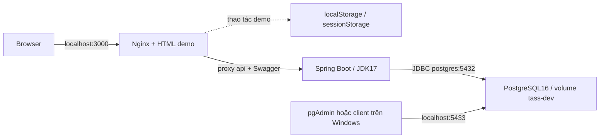

# Rà soát source và phương án Docker — 13/11/2026

## Phạm vi và kết luận

Đã rà soát các manifest/source/config trong DACN-code: root reactor, sáu module algorithm, backend main/test/resources/SQL, scripts, frontend, infra, .github và README/API docs. Các thư mục target/bin/.runtime/cache là output hoặc môi trường cục bộ, không phải nguồn build. Không có AGENTS.md áp dụng trong workspace/repo. Giữ nguyên các thay đổi SOL-01–09, không làm SOL-10.

Người dùng xác nhận mục tiêu **dev/demo local trước** và cung cấp D:/HCMUT/DACN/tass-demo.html làm frontend. Đã sao chép nguyên byte vào frontend/index.html; source gốc không đổi. Docker đóng gói được UI prototype + API + DB, nhưng **không đồng nghĩa UI đã nối backend**. Đây là phần còn thiếu lớn nhất cùng với auth thật.

## Dependency inventory

| Phần | Có trong source | Phụ thuộc và phiên bản | Đưa vào Docker |
| --- | --- | --- | --- |
| Frontend | Một HTML tự chứa ~5 MB; CSS/JS/font/ảnh nhúng; không package.json/lockfile | Browser JS, localStorage/sessionStorage; không tài nguyên CDN ngoài hoặc fetch/axios/XMLHttpRequest thực | Nginx 1.28 bookworm, không cần Node/npm build |
| Backend | 20 CRUD + plan/readiness/solver/apply/results/validation | Java 17, Boot 3.5.14, Web/JPA/Validation, Lombok; springdoc 2.10.0; PG JDBC pin 42.6.2 | Multi-stage Maven 3.9.9/Temurin 17 → Temurin 17 JRE Ubuntu Noble |
| Solver chạy trong API | algorithm/tass-cpsat:0.1.0:core | OR-Tools 9.14.6206, protobuf 4.31.1 và JNA từ dependency graph; DTO/validator Java | Trong process backend, không cần service solver riêng |
| Jackson | Solver standalone pin 2.18.3; backend dùng Boot BOM | BOM 3.5.14 trong cache quản lý Jackson 2.21.2; classifier core tránh dùng shaded CLI JAR trong Spring | Maven reactor tự giải quyết và đóng gói dependencies |
| Database | Schema PostgreSQL 15+, 48 bảng, trigger/view/JSONB/range/freshness | Compose cũ dùng PG16; máy Windows có dịch vụ PG18 | Giữ major16, postgres:16-bookworm; volume mới riêng, host5433/container5432 |
| Greedy/GA/common/benchmark/comparison | Java/Maven modules, parent comparison và CLI/shaded artifacts | Dùng core/test-helpers của CP-SAT; Java17, JUnit5.11.4 | Công cụ nghiên cứu/đối chứng, hiện API không gọi; không khởi động thành service dev |
| Tests | JUnit, Mockito, Spring Boot Test, H2 và PostgreSQL thật | Backend BOM JUnit5.12.2; CP-SAT JUnit5.11.4, Surefire/Failsafe3.5.2; Boot BOM Surefire3.5.5 | Profile test riêng, DB tmpfs riêng, không dùng dev volume |
| Docs/report | Markdown, LaTeX/PDF/diagrams | Không là runtime dependency của app | Không đưa TeX/Graphviz vào image API/UI |
| Redis/MQ/mail/object storage | Không thấy dependency/runtime call trong source hiện tại | Không có | Không tạo container dịch vụ chưa được dùng |

BOM đọc từ POM 3.5.14 hiện có trong cache: Hibernate6.6.49.Final, Lombok1.18.46, PostgreSQL42.7.10 (backend đang override bằng42.6.2). Bảng là khai báo/BOM, không thay cho dependency tree đã resolve trong một Docker build mới. Không tự nâng/hạ version dependency trong lần Dockerize này; việc pin driver/Jackson cần team thống nhất khi cập nhật.

## Kiến trúc đã chuẩn bị

Nginx proxy là đường sẵn có cho bước tích hợp; HTML hiện chưa gọi đường đó. Cổng backend host8080 để debug; host3000/8080/5433 đều bind127.0.0.1. DB Windows5432 và volume backend_postgres_data cũ được giữ nguyên. Root Compose project tass-dev dùng volume riêng; không tự sửa password, migrate hoặc xóa dữ liệu cũ.

Maven build trong image chạy package ở reactor trước để tạo classifier core, thay vì chỉ compile hoặc copy JAR build bằng JDK23 trên host. Image runtime không cần Maven/JDK compiler. Startup DB healthy → API healthy → frontend; backend bind0.0.0.0 trong container. Readiness mới /internal/health kiểm tra Boot readiness/DB/coordinator, ẩn khỏi Swagger và không trả thông tin nhạy cảm.

## Native OR-Tools

Đã đọc POM và ELF DT_NEEDED trong các JAR native9.14.6206 có trong cache:

| Arch | Native giải nén | Yêu cầu glibc tối đa | GLIBCXX tối đa |
| --- | --- | --- | --- |
| Linux x86-64 | ~64.28 MiB | GLIBC_2.26 | GLIBCXX_3.4.22 |
| Linux aarch64 | ~72.61 MiB | GLIBC_2.25 | GLIBCXX_3.4.22 |

Các thư viện ngoài JAR là loader/glibc/libm/libpthread/librt/libdl/libgcc_s/libstdc++. Runtime chọn Ubuntu Noble glibc và cài libstdc++6/libgcc-s1; không chọn Alpine/musl. JNI/JNA giải nén native xuống /tmp nên tmpfs phải cho phép executable mappings. Chưa xác nhận binary chạy bên trong Linux container tại phiên này; kết quả native Windows không được ghi thành Linux smoke test.

## Frontend/backend chưa khớp ở đâu?

| Điểm | Demo HTML | Backend hiện tại | Team cần chốt |
| --- | --- | --- | --- |
| Đăng nhập | Mô phỏng phía browser, sessionStorage/localStorage | Chưa có login/JWT/SecurityFilterChain; Principal.name hiện tra login_name của user ACTIVE | Cookie/session hay JWT, kiểu Principal, tài khoản cấp sẵn/đổi mật khẩu, ai phụ trách |
| Nguồn dữ liệu | ~12 giáo viên/36 nhu cầu giả, tên/ID nội bộ demo | 48-table schema/20 CRUD, snapshot server, DTO snake_case | Dataset dev thống nhất; bỏ giả định ID/tên của demo khi gọi API |
| Trần tải | 24 trong JS | Seed config25 theo T=A+F+C+R | Một policy được chốt và lấy từ server; không sửa ngầm hai phía |
| Solver | Hàm JS runSolver, không có network call tới CP-SAT | POST async run/poll/cancel + post-validation/apply | Chủ API client, mapping config/rules/version/run ID, xử lý 409/422/503 |
| Revision | Demo mutate thường tăng một đơn vị | Trigger tăng theo từng dòng đổi; no-op giữ revision | UI dùng revision thực từ response/current version, không cộng đoán |
| Teacher profile | Các field tổng hợp fixed/reduction/max/subjects trong một object | Nguồn tách workload basis/duty/reduction/converted/outside inventory/...; chưa có profile tổng hợp đầy đủ | Endpoint/profile aggregate hoặc tầng ghép dữ liệu; nguồn xác nhận cho F/C/R |
| Lifecycle/UI mở rộng | Sửa tay/lock, history restore, feedback, in browser | Chưa có đủ API sửa tay/lock/unlock, feedback/restore/PDF như UI demo | Phân công người làm và hợp đồng CAS/audit/validation chung |
| Giai đoạn | Không đại diện đủ khoảng hiệu lực DB | Solver/workload MVP một khoảng đồng nhất; seed DB có nhiều giai đoạn và accounts DISABLED | Tạo dataset dev đồng nhất + tài khoản hợp lệ khi auth xong; không làm SOL-10 |

Vì auth chưa nối, tài khoản demo trong HTML không đăng nhập được vào backend. Proxy không giả mạo Principal hoặc thêm header user để bỏ RBAC. CRUD cũ chưa có bảo vệ auth toàn cục; stack này chỉ là local demo, không là cấu hình public server.

## Danh sách gửi team để chốt

1. **FE và chủ tích hợp:** giữ HTML/JS hiện tại hay chuyển framework? Nếu chuyển, cần repo/branch, package.json, lockfile, Node version, build/start command; hiện không có để Dockerize một app React/Vue giả định.
2. **Auth contract:** loại session/token, Principal.name là login_name hay ID, school/roles/scopes, luồng cấp tài khoản và đổi mật khẩu; ai chịu trách nhiệm backend + FE? Adapter hiện giữ login_name, chưa coi là thiết kế auth đã chốt.
3. **Policy và dataset:** trần minh họa24 hay25, số lượng giáo viên/nhu cầu, thời kỳ đồng nhất, nguồn F/C/R/experience và xác nhận inventory; tạo một bộ demo dùng được với backend thật. Giữ quyết định T đã có.
4. **Dữ liệu cũ:** DB/volume nào cần giữ/import, PG16 trong Docker hay cần đồng bộmajor với PG18 của một thành viên? Ai quản lý mật khẩu, backup và restore? Hiện không tự tái sử dụng dữ liệu cũ.
5. **Phần API còn thiếu:** profile giáo viên tổng hợp, manual edit/lock/unlock, restore/feedback/PDF và người phụ trách; thống nhất dùng revision/token/validator của SOL-01–09.
6. **Môi trường build:** Windows x64/ARM64 của các máy; Docker Desktop Linux engine và quyền của user; mạng tới Docker Hub/Maven Central/Ubuntu APT, cần mirror/proxy không? Các image tags hiện là cấu hình đề xuất, chưa pin digest đã pull/kiểm chứng.
7. **Vận hành dev:** host ports3000/8080/5433, API memory2GiB/CPU2, heap50%, solver concurrent1/queue8 là mặc định đề xuất. Team xác nhận cấu hình máy trước khi chuẩn hóa; chưa là số đo capacity production.
8. **Dependency/migration/CI:** giữ pinPG JDBC42.6.2 hay dùng BOM42.7.10; cách quản lý Jackson riêng của CLI/backend; quy trìnhreviewSQL03–08 hay áp Flyway/Liquibase sau; CI chạy profile test và chính sách pinimage digest. Không tự publish image/deploy server.

## Kiểm chứng và giới hạn

- Compose2.40.3 config --quiet đã qua với .env.example và cả profiles test/tools; Dockerfiles/COPY inputs được rà soát với .dockerignore.
- PowerShell helper parse không lỗi; các script POSIX qua bash -n. Demo HTML copy SHA-256 giống file gốc; một script inline được parse bằng Node VM, không có external script/resource cần tải và không có API network call sau khi loại payload data URI khỏi phép rà soát.
- **157/157 test backend đạt** sau khi thêm readiness: 112 tích hợp/hồi quy, 1 JVM mới đọc lại kết quả, 23 test backend cũ, 21 PostgreSQL CRUD/status. Native và DB ở lượt này là Windows/JDK17/PostgreSQL18 tạm, không phải Linux Docker. Log tại D:/HCMUT/DACN/tmp/docker-audit-20261113/; cluster test đã dừng, DB người dùng không bị thay đổi.
- Docker client29.0.1/Compose2.40.3/Buildx0.29.1 có sẵn, nhưng agent không đọc được Docker config của user và bị permission denied khi gọi engine. Chưa chạy docker build/pull/up, nginx -t trong image, Linux JNI smoke hoặc test profile trong container. Không coi config validation hay test Windows là image đã build/chạy thành công.
- Các cache Maven cục bộ trước đó thiếu class plugin Surefire/Clean; Docker build được thiết kế tải dependencies trong môi trường Maven/JDK17 mới, nhưng vẫn cần mạng và phải chạy kiểm chứng thật khi có quyền engine.

Không thay dữ liệu DB đang dùng. Hướng dẫn chạy, kiểm tra và backup/migration tại [README.md](README.md).

## Tài liệu gốc đã đối chiếu

- [Docker Compose networking](https://docs.docker.com/compose/how-tos/networking/): service DNS và host/container port khác nhau.
- [Docker Compose startup order](https://docs.docker.com/compose/how-tos/startup-order/): depends_on kết hợp service_healthy.
- [Official PostgreSQL image](https://github.com/docker-library/docs/blob/master/postgres/README.md): init scripts/POSTGRES_PASSWORD chỉ có tác dụng khởi tạo ở volume mới.
- [Temurin container sources](https://github.com/adoptium/containers/blob/main/17/jre/ubuntu/noble/Dockerfile): runtime JRE17 Ubuntu Noble.
